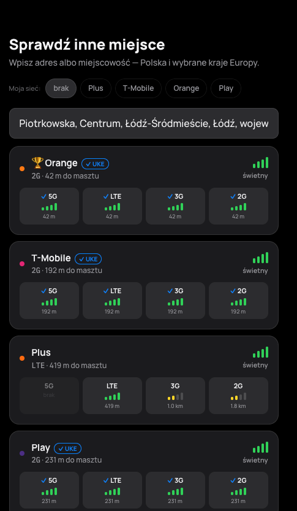
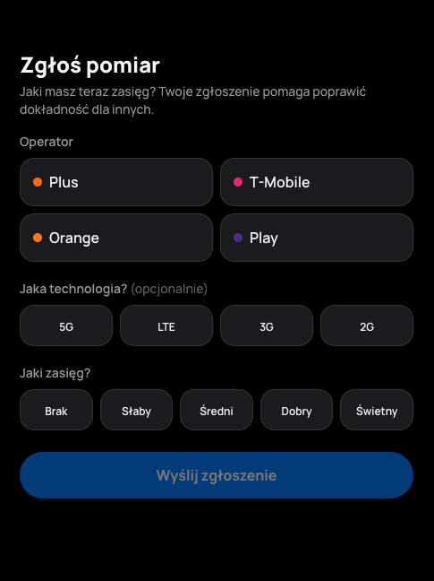

# mapa zasięgu

Mapa zasięgu internetu mobilnego w Polsce. Mapy operatorów pokazują to, co wychodzi z ich modelu, a nie to, co faktycznie masz w telefonie, więc chciałem sprawdzić, ile da się wyciągnąć z otwartych danych.

Podajesz adres albo bierzesz swoją lokalizację z telefonu i dostajesz dla każdego z czterech dużych operatorów: jak dobry jest zasięg, jaka technologia (2G/3G/LTE/5G) i jak daleko jest najbliższy maszt. Można też samemu zgłosić, ile kresek masz w danym miejscu.

  
  

## funkcje

- teraz - zasięg w miejscu, w którym właśnie jesteś
- szukaj - dowolny adres albo miejscowość w Polsce i wybranych krajach Europy
- moja sieć - wybierasz swojego operatora i jego wynik jest wyróżniony, a za granicą widać sieci z tej samej grupy
- wynik dla każdego operatora - ogólna ocena, odległość do najbliższego masztu i rozbicie na 5G, LTE, 3G i 2G
- oznaczenie oficjalnych danych - wynik oparty na rejestrze UKE ma osobną plakietkę
- zgłoś pomiar - wybierasz operatora, technologię i ile masz zasięgu, a zgłoszenie poprawia wynik dla innych
- offline - zapisane wyniki są dostępne bez internetu

## skąd dane

- OpenCellID - otwarta baza masztów, zbierana przez ludzi. Ma dużo danych, ale zasięgi bywają mocno zawyżone, więc je przycinam do rozsądnych wartości.
- UKE - oficjalny rejestr pozwoleń radiowych. Dokładniejszy i ma dużo więcej 5G.
- zgłoszenia użytkowników - jeśli w promieniu ~800 m są co najmniej 3 zgłoszenia z ostatnich 90 dni, to biorę ich medianę zamiast wyliczenia.

Import z OpenCellID i UKE idzie paczkami w zadaniach w tle, bo plików jest za dużo na jeden request.

## jak liczę zasięg

Bez żadnego ML. Biorę 5 najbliższych masztów operatora, dla każdego liczę stosunek jego zasięgu do odległości i mnożę przez wagę technologii (2G prawie się nie liczy, bo to mapa internetu, a nie samego sygnału). Najlepszy maszt plus mały bonus za gęstość daje wynik od "brak" do "świetny". Odległość to linia prosta, więc w górach i w lesie wynik bywa zbyt optymistyczny.

## co jest w repo

Tylko wybrane pliki, nie cały projekt:

- `lib/coverage.js` - wyliczanie zasięgu (uproszczona wersja, bez operatorów zagranicznych)
- `lib/geo.js` - odległość i prefiltr po prostokącie
- `sql/schema.sql` - tabele masztów i zgłoszeń

## technologie

JavaScript, PostgreSQL, Alpine.js, Tailwind, PWA z zapisem wyników offline.

Więcej o mnie: [alex-rakowski.hatchable.site](https://alex-rakowski.hatchable.site)
